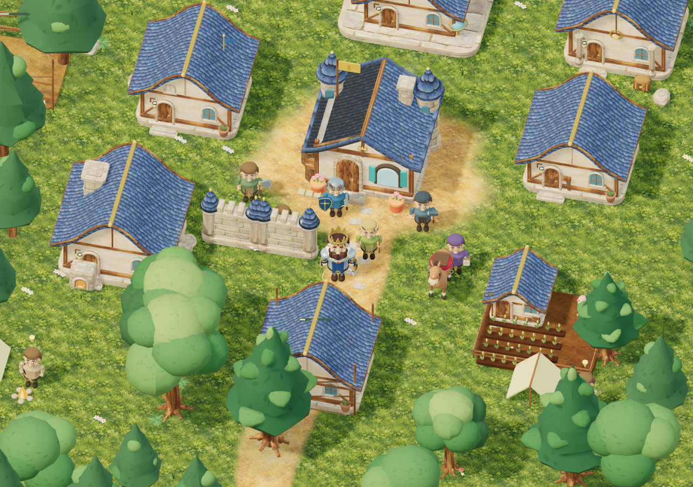

# Courvane · V4.0.0

**Bâtissez votre héritage.** Après la chute de Valdor, personnalisez votre souverain, retrouvez son peuple, attribuez ses métiers et reconstruisez un royaume en 3D. La V4 refond la direction artistique : personnages sculptés, matériaux peints, architecture aux lignes courbes, forêt plus naturelle et éclairage doux. Les systèmes de royaume de la V3 sont conservés.



Capture réelle de la scène de validation avec six métiers et dix ouvrages. [Voir le nouveau roi et sa personnalisation](docs/v4-portrait.png).

## Jouer sur PC

1. Télécharger **Courvane-PC-V4.zip** et choisir **Extraire tout**.
2. Ouvrir le dossier **Courvane-PC**.
3. Double-cliquer sur **LANCER-JEU.bat**, ou ouvrir `jeu-pc.html` avec Edge, Chrome ou Firefox récent.

WebGL 2 et accélération graphique nécessaires. Le jeu et le moteur sont intégrés dans le fichier : aucun serveur ni connexion n’est nécessaire après le téléchargement. Le jeu occupe toute la fenêtre ; le plein écran du navigateur se choisit dans Options.

Au lancement, choisissez le nom, le teint, les cheveux, la barbe, la cape et la couronne du roi. L’aperçu 3D réagit immédiatement.

## Commandes

| Action | PC | Mobile |
| --- | --- | --- |
| Déplacement | ZQSD, WASD ou flèches | Joystick |
| Monter, descendre, secourir, fouiller | E | Bouton contextuel |
| Arc / hache | 1 / 2 | Boutons d’arme |
| Frapper ou couper | F avec la hache | Bouton Frapper / couper |
| Conseil du royaume, pause | M, Échap ou Espace | Bouton Royaume |
| Catalogue de construction | B | Onglet Construction |
| Placer un ouvrage | Choisir le terrain, puis Placer ou Entrée | Toucher le terrain, puis Placer |
| Rotation / annulation du plan | R / Échap | Boutons Tourner / Annuler |

## Première partie

Explorez les camps pendant les accalmies et ramenez un survivant. Dans **Habitants**, choisissez son métier : il n’en reçoit aucun automatiquement. Un constructeur peut commencer une maison ou une ferme ; un ouvrier apporte les matières ; un fermier travaille dans une ferme terminée. Préparez des chevaliers avant les assauts annoncés et une forge pour leur armement.

Les places proviennent seulement des logements achevés. Les engagements et voyageurs en route comptent dans les réservations. Les origines visent toujours 20 % d’arrivées spontanées, 30 % d’engagements et 50 % de secours. Une fois les camps initiaux explorés, de nouveaux réfugiés peuvent réapparaître sous conditions de place et de délai.

Les habitants, le roi et le royaume ont chacun une progression en XP et en niveaux. À partir du niveau 3 du royaume ou de dix habitants, les travailleurs attendent un salaire toutes les minutes de jeu actif. Le menu affiche coûts, motivation, efficacité, réserves alimentaires et alertes. Les inventeurs se débloquent au niveau 4 avec une académie, puis produisent du savoir et développent les technologies.

Les mécanismes, coûts, remboursements et limites sont détaillés dans [DESIGN-V3.md](DESIGN-V3.md). La disponibilité du nouveau nom est documentée dans [NAME-RESEARCH.md](NAME-RESEARCH.md) : aucune occurrence trouvée dans la recherche GitHub accessible, mais les catalogues de jeux ont été bloqués par le réseau. L’exclusivité du nom n’est pas affirmée.

## Développement

Node.js 24 et Python 3 pour construire le paquet PC :

```sh
npm ci
npm run build:pc
npm start
```

Port 3000 par défaut ; `PORT=3200 npm start` permet un autre port. Chaque tâche cloud est isolée : utiliser le dépôt existant, sans créer de worktree sauf demande explicite.

- `simulation.js` : règles et progression indépendantes du navigateur.
- `kingdom-data.js` : métiers, ouvrages, recherches et coûts.
- `world-data.js` : région, camps, lieux, forêt et index spatial.
- `world3d.js` : scène, caméra, animation, secteurs et niveaux de détail.
- `royal-models.js` : personnages sculptés, visages, coiffures, vêtements et équipements.
- `royal-architecture.js` : bâtiments, ouvertures cintrées et toitures courbes.
- `painted-textures.js`, `art-assets.js`, `assets/` : atlas peint original et cartes de relief/rugosité locales.
- `game.js`, `index.html`, `style.css` : interface, personnalisation, commandes et placement.
- `brand.js` : nom et version du jeu.

`npm run build` assemble ces modules et Three.js dans `game.bundle.js`. `npm run build:pc` reconstruit aussi le document autonome et `Courvane-PC-V4.zip`. `Courvane-PC.zip` et `Royaume-PC.zip` sont des alias de la version courante. Les archives V1/V2/V3 et leurs tags sont conservés. Le détail de la refonte visuelle figure dans [DESIGN-V4.md](DESIGN-V4.md). L’atlas est inclus dans le script assemblé : aucun téléchargement d’image au lancement.

Les modèles sont des créations procédurales originales inspirées des images transmises, sans reprise de leurs fichiers ni de leurs filigranes. Les parties statiques sont regroupées avec couleurs de sommets, les arbres instanciés par secteurs et niveaux de détail. La licence de Three.js est incluse dans l’archive.

## Vérifications

```sh
npm test
npm run test:browser
npm run test:pc
npm run test:graphics
```

Les tests couvrent les anciennes mécaniques (cheval, exploration, escortes, assauts), puis la hache, la capacité, les réservations, les six métiers, la construction, les améliorations, les ressources, les salaires, les niveaux et les recherches. Les tests navigateur exercent le formulaire, les menus, les choix de métiers, les emplacements réels sur le terrain, les boutons tactiles et les neuf formats d’écran.

Le test graphique construit un village représentatif avec les six métiers et dix ouvrages, compare les silhouettes et les personnalisations, vérifie le chargement de l’atlas, la stabilité des images en pause, les ressources GPU après reconstructions et le cadrage mobile. Les captures et compteurs sont écrits dans `/tmp/courvane-v4-qa`. Une référence V3 peut être fournie avec `GRAPHICS_BASELINE_ROOT`. Ces compteurs ne mesurent pas la fluidité d’un téléphone réel.

Le test PC extrait le ZIP dans un chemin contenant des espaces, vérifie sa version et le script exact, puis exerce l’édition en mode hors réseau. La politique du navigateur cloud bloque `file://` et `data:` : le document extrait est testé via `page.setContent`. Le batch et le double-clic Windows doivent encore être confirmés sur un appareil réel. Les essais matériels iPhone restent également nécessaires. Les entrées sont dimensionnées pour le toucher ; sur mobile, leurs caractères restent à 16 px pour éviter le zoom automatique de Safari.

Chromium est détecté dans `/usr/bin/chromium`, ou via `CHROMIUM_PATH`. Sinon : `npx playwright install chromium`. WebKit est utilisable après installation avec `BROWSER=webkit npm run test:browser`, mais n’a pas pu être téléchargé ici. Les accès internes utilisés par les tests sont injectés dans leurs seules réponses et ne sont pas livrés au joueur.

## Hébergement

Pour GitHub Pages, servir `index.html`, `style.css` et `game.bundle.js`, avec leurs chemins relatifs. Les polices Google de la version web sont facultatives et retirées de l’édition PC. Aucun secret n’est requis. Ne pas rendre un dépôt privé public sans autorisation.

## Limites actuelles

La sauvegarde entre sessions et la reconquête territoriale ne sont pas encore disponibles. Les inventions utilisent un premier arbre de trois technologies définies. Les essais sur matériel Windows/iPhone et la disponibilité du nom dans les catalogues de jeux restent à confirmer.
