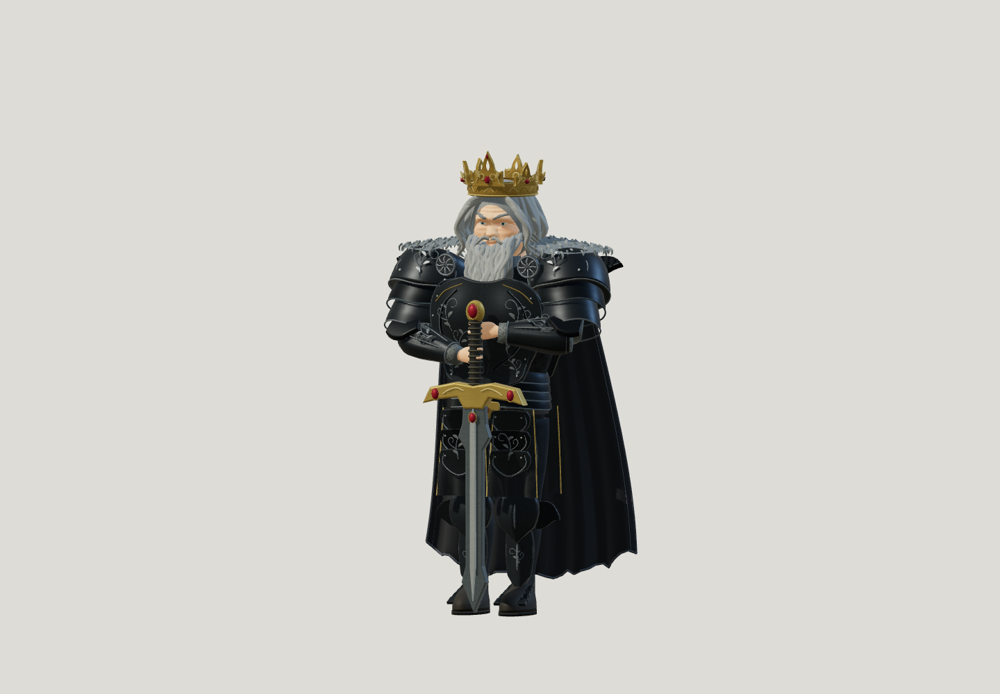

# Cendrune · V5.6.0

**Bâtissez votre héritage.** Après la chute de Valdor, personnalisez votre souverain, retrouvez son peuple, attribuez ses métiers et reconstruisez un royaume en 3D. La V5.6 se concentre sur le roi : visage mature, cheveux et barbe grisonnants, armure sombre et couronne dorée posée sur les cheveux. Son visage et ses mains utilisent une base anatomique retravaillée ; les vêtements, les cheveux, la barbe et les insignes royaux sont créés pour le jeu. Les habitants, les animaux et les règles de jeu restent ceux de la V5.5.



Vues du modèle de production réalisées avec le moteur du jeu : [buste](docs/v5.6-bust.png) · [visage](docs/v5.6-face.png) · [couronne](docs/v5.6-crown.png) · [mains](docs/v5.6-hands.png) · [portrait de création](docs/v5.6-portrait.png). Les cadrages rapprochés servent au contrôle des détails.

Le roi porte une armure sombre, une cape noire par défaut et une couronne ouvragée sans casque. Le visage et les mains dérivent uniquement de données de maillage MakeHuman publiées sous CC0, adaptées aux proportions et au caractère du souverain. Leur provenance, leur empreinte et la licence complète figurent dans [assets/licenses/makehuman-cc0.txt](assets/licenses/makehuman-cc0.txt). Les aperçus des [animaux](docs/v5.5-horse.png) et des [métiers](docs/v5.5-professions.png) de la V5.5 restent disponibles.

## Jouer sur PC

1. Télécharger **[Cendrune-PC-V5.6.zip](Cendrune-PC-V5.6.zip)** et choisir **Extraire tout**.
2. Ouvrir le dossier **Cendrune-PC**.
3. Double-cliquer sur **LANCER-JEU.bat**, ou ouvrir `jeu-pc.html` avec Edge, Chrome ou Firefox récent.

WebGL 2 et accélération graphique nécessaires. Le jeu et le moteur sont intégrés dans le fichier : aucun serveur ni connexion n’est nécessaire après le téléchargement. Le jeu occupe toute la fenêtre ; le plein écran du navigateur se choisit dans Options.

Au lancement, nommez votre roi et votre royaume. Choisissez une tenue, une coiffure, un emblème, la couleur des yeux, le teint, la barbe, la cape, la couronne et la robe de votre cheval. L’aperçu 3D réagit immédiatement ; trois styles préparés permettent de commencer rapidement.

## Commandes

| Action | PC | Mobile |
| --- | --- | --- |
| Déplacement | ZQSD, WASD ou flèches | Joystick |
| Monter, descendre, secourir, fouiller | E | Bouton contextuel |
| Arc / hache | 1 / 2 | Boutons d’arme |
| Viser et tirer / frapper | Cliquer sur le terrain ou une cible | Toucher le terrain ou une cible |
| Répéter un coup de hache vers la cible | F | Action de la hache |
| Élan royal · niveau 2 | Maj | Bouton Élan |
| Frappe royale · niveau 3 | C | Bouton Pouvoir |
| Conseil du royaume, pause | M, Échap ou Espace | Bouton Royaume |
| Catalogue de construction | B | Onglet Construction |
| Placer un ouvrage | Choisir le terrain, puis Placer ou Entrée | Toucher le terrain, puis Placer |
| Rotation / annulation du plan | R / Échap | Boutons Tourner / Annuler |

Les sept ressources restent visibles en haut à gauche ; la mini-carte ronde est en haut à droite et ouvre la grande carte. Le curseur de zoom des Options descend à 0,45 pour prendre davantage de recul.

## Première partie

Explorez les camps pendant les accalmies et ramenez un survivant. Dans **Habitants**, choisissez son métier : il n’en reçoit aucun automatiquement. Un constructeur peut commencer une maison ou une ferme ; un ouvrier apporte les matières ; un fermier travaille dans une ferme terminée. Préparez des chevaliers avant les assauts annoncés et une forge pour leur armement.

Les places proviennent seulement des logements achevés. Les engagements et voyageurs en route comptent dans les réservations. Les origines visent toujours 20 % d’arrivées spontanées, 30 % d’engagements et 50 % de secours. Une fois les camps initiaux explorés, de nouveaux réfugiés peuvent réapparaître sous conditions de place et de délai.

Les habitants, le roi et le royaume ont chacun une progression en XP et en niveaux. À partir du niveau 3 du royaume ou de dix habitants, les travailleurs attendent un salaire toutes les minutes de jeu actif. Le menu affiche coûts, motivation, efficacité, réserves alimentaires et alertes. Les inventeurs se débloquent au niveau 4 avec une académie, puis produisent du savoir et développent les technologies.

Le roi ne tire plus automatiquement : choisissez votre cible au clic ou au toucher. Les niveaux débloquent une esquive, une attaque puissante puis de nouvelles possibilités d’exploration. Certains lieux réservent des rencontres et des récompenses uniques. La vie du roi peut baisser lors de ces rencontres ; un repli au refuge évite de perdre la partie.

Les règles économiques restent détaillées dans [DESIGN-V3.md](DESIGN-V3.md), le combat et l’exploration dans [DESIGN-V5.md](DESIGN-V5.md), les personnages et animaux dans [DESIGN-V5.5.md](DESIGN-V5.5.md), le nouveau souverain dans [DESIGN-V5.6.md](DESIGN-V5.6.md). Le nom **Cendrune** a donné zéro dépôt dans la recherche GitHub accessible ; les catalogues de jeux ont été bloqués par le réseau. L’exclusivité du nom n’est pas affirmée : voir [NAME-RESEARCH-V5.md](NAME-RESEARCH-V5.md).

## Développement

Node.js 24 et Python 3 pour construire le paquet PC :

```sh
npm ci
npm run build:pc
npm start
```

Port 3000 par défaut ; `PORT=3200 npm start` permet un autre port. Chaque tâche cloud est isolée : utiliser le dépôt existant, sans créer de worktree sauf demande explicite.

Les données anatomiques converties sont déjà incluses dans le dépôt : le build courant ne nécessite pas Blender. Leur régénération utilise Blender et le fichier `base.obj` dont l’empreinte est documentée dans [assets/README.md](assets/README.md) :

```sh
blender -b -t 2 --python scripts/build-king-anatomy.py -- --source /chemin/vers/base.obj
```

Le script vérifie l’empreinte de la source. Sa sortie par défaut est `assets/v56-king-anatomy.json` ; `--output` permet de choisir un autre emplacement.

- `simulation.js` : règles et progression indépendantes du navigateur.
- `kingdom-data.js` : métiers, ouvrages, recherches et coûts.
- `world-data.js` : région, camps, lieux, forêt et index spatial.
- `world3d.js`, `forest-models.js` : scène, effets de ciblage/capacités, feuillages, secteurs et niveaux de détail.
- `animal-models.js` : cheval articulé, pelage, robe, sellerie et détails du harnachement.
- `progression-data.js` : capacités par niveau et reliques.
- `icons.js` : pictogrammes SVG des matériaux, métiers et bâtiments.
- `royal-models.js` : personnages sculptés, visages, coiffures, vêtements et équipements.
- `assets/v56-king-anatomy.json`, `scripts/build-king-anatomy.py` : données anatomiques adaptées pour le roi et conversion reproductible du maillage source CC0.
- `royal-architecture.js` : bâtiments, ouvertures cintrées et toitures courbes.
- `painted-textures.js`, `art-assets.js`, `assets/` : atlas peint original et cartes de relief/rugosité locales.
- `game.js`, `index.html`, `style.css` : interface, personnalisation, commandes et placement.
- `brand.js` : nom et version du jeu.

`npm run build` assemble ces modules, les données anatomiques et Three.js dans `game.bundle.js`. `npm run build:pc` reconstruit aussi le document autonome et `Cendrune-PC-V5.6.zip`. `Cendrune-PC.zip`, `Courvane-PC.zip` et `Royaume-PC.zip` sont des alias de la version courante. Le nom de l’archive conserve la version mineure ; les archives V1/V2/V3/V4/V5/V5.5 et leurs tags sont conservés. Les trois atlas et le maillage du roi sont intégrés au script : aucun téléchargement de ces ressources au lancement.

Les armures, vêtements, cheveux, barbes, couronnes et décors sont des créations du projet inspirées des images transmises. Le visage et les mains du roi sont adaptés du maillage de base MakeHuman hm08 publié sous CC0 ; aucun code du logiciel MakeHuman n’est utilisé. Les données converties sont intégrées au paquet. Les parties statiques sont regroupées avec couleurs de sommets, les arbres instanciés par secteurs et niveaux de détail. `THIRD-PARTY-NOTICES.txt` réunit la licence MIT de Three.js, la provenance anatomique et le texte complet de CC0 ; ce document est aussi inclus dans l’archive PC.

## Vérifications

```sh
npm test
npm run test:browser
npm run test:pc
npm run test:graphics
npm run test:models
npm run test:realistic
```

Les tests V5 couvrent la visée manuelle, les capacités, leurs niveaux requis, les récompenses uniques et les protections des lieux secrets. Les tests navigateur vérifient le HUD, la mini-carte, les gestes de visée, les choix d’apparence et le nom du royaume. Les tests couvrent aussi les anciennes mécaniques (cheval, exploration, escortes, assauts), puis la hache, la capacité, les réservations, les six métiers, la construction, les améliorations, les ressources, les salaires, les niveaux et les recherches. Les tests navigateur exercent le formulaire, les menus, les choix de métiers, les emplacements réels sur le terrain, les boutons tactiles et les neuf formats d’écran.

Le test graphique construit un village représentatif avec les six métiers et dix ouvrages, compare les silhouettes et les personnalisations, vérifie le chargement de l’atlas, la stabilité des images en pause, les ressources GPU après reconstructions et le cadrage mobile. Les captures et compteurs sont écrits dans `/tmp/cendrune-v5-qa`. Une référence antérieure peut être fournie avec `GRAPHICS_BASELINE_ROOT`. Ces compteurs ne mesurent pas la fluidité d’un téléphone réel.

Les contrôles de la V5.5 ajoutent les proportions anatomiques, les sommets et indices des nouveaux modèles, les articulations du cavalier et la réutilisation des formes. Les vues rapprochées du roi, du cheval, des cochons et des métiers utilisent les modèles et matériaux de production ; leurs accès de studio sont injectés uniquement par les tests. Les captures et mesures correspondantes sont écrites dans `/tmp/cendrune-realistic-qa`.

Les contrôles de la V5.6 portent sur le souverain, ses données anatomiques, les choix de personnalisation et les vues du visage, du buste, de la couronne et des mains. Les accès de contrôle restent propres aux tests. Le paquet PC conserve sa vérification du script exact et de son fonctionnement hors réseau.

Le test PC extrait le ZIP dans un chemin contenant des espaces, vérifie sa version et le script exact, puis exerce l’édition en mode hors réseau. La politique du navigateur cloud bloque `file://` et `data:` : le document extrait est testé via `page.setContent`. Le batch et le double-clic Windows doivent encore être confirmés sur un appareil réel. Les essais matériels iPhone restent également nécessaires. Les entrées sont dimensionnées pour le toucher ; sur mobile, leurs caractères restent à 16 px pour éviter le zoom automatique de Safari.

Chromium est détecté dans `/usr/bin/chromium`, ou via `CHROMIUM_PATH`. Sinon : `npx playwright install chromium`. WebKit est utilisable après installation avec `BROWSER=webkit npm run test:browser`, mais n’a pas pu être téléchargé ici. Les accès internes utilisés par les tests sont injectés dans leurs seules réponses et ne sont pas livrés au joueur.

## Hébergement

Pour GitHub Pages, servir `index.html`, `style.css` et `game.bundle.js`, avec leurs chemins relatifs. Les polices Google de la version web sont facultatives et retirées de l’édition PC. Aucun secret n’est requis. Ne pas rendre un dépôt privé public sans autorisation.

## Limites actuelles

La sauvegarde entre sessions et la reconquête territoriale ne sont pas encore disponibles. Les inventions utilisent un premier arbre de trois technologies définies. Les essais sur matériel Windows/iPhone et la disponibilité du nom dans les catalogues de jeux restent à confirmer.
